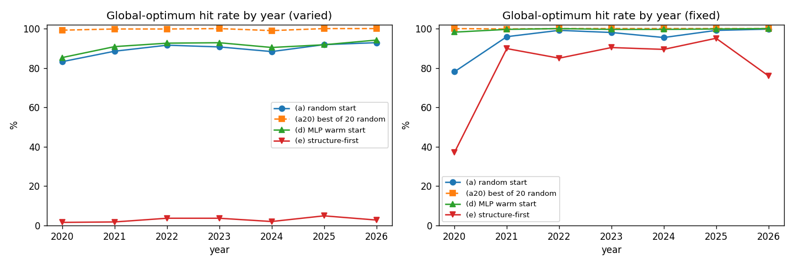
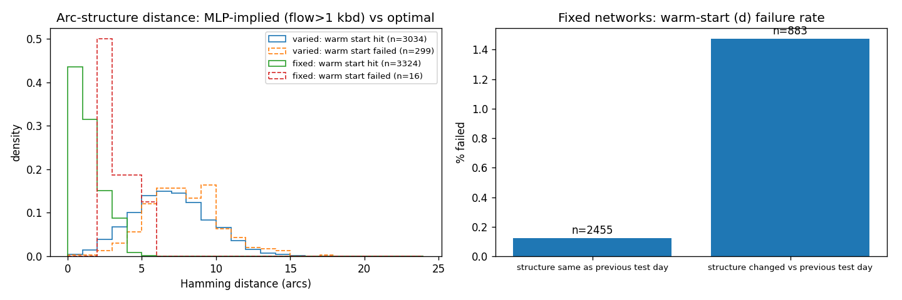

# pooling-warmstart — learned warm starts for the nonconvex pooling problem

## At a glance

**Question:** can a neural network predict starting points that lead a fast local solver (IPOPT) to the global
optimum of a nonconvex pooling problem built from real refinery data?

**Built:** 9,898 crude-blending instances from EIA prices (2006–2026) and 82 Equinor/BP crude assays, each solved
with SCIP: 9,866 certified globally optimal and 32 proven infeasible. There is also a 9,898-instance variant that
reuses 2 fixed networks on every date.

- **Warm starts help clearly when the network repeats, and only slightly when it doesn't** (test set 2020–2026,
  global-optimum hit rate):
  - Fixed networks: 99.5% learned vs 94.9% random start.
  - A new network per instance: 91.0% vs 89.5% (paired +1.57 pp, 95% CI +0.77 to +2.37).
- **The local solver does get trapped:** 12.2% of random-start IPOPT runs end at a worse local optimum.
- **Speed:** warm-started IPOPT takes 0.1248 s per instance vs 0.9177 s for SCIP. SCIP also certifies optimality,
  and these instances are easy for it.
- **KKT projection layer:** mass balances are met exactly (residual p95 7.63e-06 kbd). The bilinear quality
  constraints are outside its scope and stay violated (mean 0.175), so no raw prediction is feasible on its own.

More detail: [results/results.md](results/results.md) (all tables), [findings.md](findings.md) (plain-language
findings), [DECISIONS.md](DECISIONS.md) (every assumption), [data_report.md](data_report.md) (data access audit).

## Key results

Main benchmark: a new random network per (date, sample), 3,333 test instances dated 2020–2026, trained on 2006–2017.

| method | global-opt hit rate | mean gap | p95 gap | mean time (s) | constraint violation |
|---|---|---|---|---|---|
| (a) IPOPT, random start (per start) | 89.5% | 0.0021 | 0.0021 | 0.1305 | 0.0% > 1e-5 |
| (a20) IPOPT, best of 20 random starts | 99.7% | 0.0000 | 0.0000 | 2.6102 | — |
| (b) MLP flows, raw prediction | 0.0% | 0.1367 | 0.4379 | 0.0005 | 96.5% > 1e-5 |
| (c) MLP + KKT projection, raw | 0.0% | 0.1292 | 0.4104 | 0.0005 | 99.1% > 1e-5 |
| (d) MLP warm start → IPOPT | 91.0% | 0.0014 | 0.0012 | 0.1248 | 0.0% > 1e-5 |
| (e) structure-first (classifier + reduced IPOPT) | 2.9% | 0.1169 | 0.4871 | 0.1257 | 9.3% > 1e-5 |
| (f) SCIP global (reference) | 100.0% | 0.0000 | 0.0000 | 0.9177 | feasible |

How to read the table:

- **hit:** feasible (max violation ≤ 1e-5) and within 1e-4 (relative) of SCIP's certified optimum.
- **gap:** (obj − obj\*) / max(1, |obj\*|), signed.
- **time:** solver call only, plus NN inference; measured with 19 concurrent processes.

On the **fixed-network** variant (3,340 test instances):

| method | hit rate |
|---|---|
| (a) random start | 94.9% |
| (d) MLP warm start | 99.5% (paired +4.65 pp, CI +4.06 to +5.25) |
| (e) structure-first | 80.4% |

Warm-start failures there cluster on days when the optimal structure changed from the previous test day: 13 of
883 such days (1.47%), versus 3 of 2,455 days (0.12%) when it didn't. Per-year tables are in
[results/results.md](results/results.md).





## Hard-constraint layers on pooling

Method (c) uses the KKT projection layer of Chen, Constante-Flores & Li (2024), *"Physics-informed neural networks
with hard linear equality constraints"*. It maps the network's output to the closest point satisfying a set of
linear equalities, and the network is trained end-to-end through it. Here it is applied to the tank mass balances
(inflow = outflow for each tank).

**What it achieved:**

- **Exact mass balances.** The violation drops from 15.8 kbd (mean; p95 30.7) for the plain MLP to 3.05e-06 kbd
  (mean; p95 7.63e-06), which is float32 rounding.
- **A modest accuracy improvement on the main benchmark** (single seed):
  - validation loss 0.01446 vs 0.01556
  - mean objective gap of the raw prediction 0.1292 vs 0.1367
- **On the fixed-network variant the picture is mixed:**
  - mean objective gap improves, 0.0040 vs 0.0091
  - validation loss is slightly higher, 0.001021 vs 0.000971

**Scope:**

- **Linear equalities only.** The method is designed for linear equality constraints. In pooling, the quality
  constraints through the tanks (sulfur, density, acidity of blended tank contents) are bilinear: flow × tank
  composition. They are outside its intended scope.
  - Quality-spec violation: mean 0.175, p95 0.677 (spec units, e.g. wt% S).
  - Plain MLP: mean 0.185, p95 0.73.
- **Bounds are not enforced** by the projection, so some projected flows went negative: up to 11.1 kbd on the main
  benchmark and 4.34 kbd on the fixed networks.
- **Later work:** the group's later decision-rule method (Constante-Flores, Chen & Li, NeurIPS 2025) enforces
  linear equality *and* inequality constraints, so it would be expected to handle the bounds. It was not tested here.

**Open question:** how to enforce bilinear, pooling-type quality constraints inside learned models, or how best to
combine hard-constraint layers with a local solver. This benchmark provides 9,898 certified instances (plus the
fixed-network variant) for studying it.

## Limitations

- Single training seed, no hyperparameter tuning.
- Individual crude prices are **modeled** (Brent + an API-gravity differential fitted to EIA monthly landed costs),
  not observed. The sulfur term was dropped because its fitted sign was wrong (see DECISIONS.md).
- Atmospheric residue is valued at a fixed 0.85 × Brent.
- CDU feed specs (sulfur, API window, TAN, throughput limits) are design assumptions, jittered ±10% per instance.
- Not tested: the decision-rule method and nonlinear correction steps for the projected predictions. The projected
  predictions (c) were also not used as warm starts; only the plain MLP prediction (b) was.

## Layout

| path | content |
|---|---|
| `data/raw/` | EIA, MINLPLib and eCFR downloads exactly as fetched (`access_log.jsonl` records every request). Equinor, BP and GAMS files are **not redistributed**; see below |
| `data/clean/` | `prices_daily.csv`, `crudes.csv`, `pooling_instances.csv` (built by `scripts/clean.py`) |
| `data/instances/` | generated instances: `instances.parquet` (new network per date/sample), `instances_fixed.parquet` (2 networks reused on every date), `design.json`, `fixed_networks.json` |
| `data/solved/` | SCIP + IPOPT-multistart results (`parts/`, `parts_fixed/` batch files; `solved.parquet`, `solved_fixed.parquet` consolidated) |
| `src/pooling.py` | general pooling model: pq / p formulations (Pyomo), SCIP global model, evaluator |
| `src/gamslib_pool.py` | reader for the GAMS-library literature instances (validation) |
| `src/realdata.py` | yields, price model, network sampling, instance (de)serialisation |
| `src/runner.py` | parallel, batched, resumable solver driver (Phase 3/4) |
| `src/learn.py`, `src/evalwork.py` | features, models (MLP, KKT projection, classifier), per-instance evaluation |
| `scripts/` | download scripts, one script per phase; `report.py` builds `results/results.md` and `results/plots/` |

## Reproduce from raw data

Requirements: Python 3.12 with `pandas numpy openpyxl xlrd pyarrow pyomo pyscipopt torch scikit-learn matplotlib
tabulate`. IPOPT comes from the IDAES binaries:

1. `pip install idaes-pse`
2. `idaes get-extensions`
3. Copy the `idaes/bin` folder somewhere the OS loader can see it, and point the `IDAES_BIN` env var at it
   (default `~/solvers/idaes_bin`; see DECISIONS.md for why this is needed with the Microsoft Store Python).

**Third-party files not in this repository.** The Equinor and BP assay files and the GAMS Model Library `pool`
files are not redistributed. Fetch them first:

```
python -P scripts/get_equinor.py    # 46 assay XLSX + page -> data/raw/equinor/
python -P scripts/get_bp.py         # 36 assay files + page -> data/raw/bp/
python -P scripts/get_gamslib.py    # pool.254, poolmod.inc -> data/raw/gamslib/
```

On 2026-10-22 a fresh download was byte-identical to the files used for the published results. The companies
update their assays, so later downloads may differ.

Then run the steps in order. Steps 5–7 take about 1 h total on 19 worker processes.

1. `python -P scripts/clean.py`: raw → `data/clean/`.
2. `python -P scripts/phase1_validate.py`: literature instances → `results/validation.csv`.
3. `python -P scripts/phase2_build.py`: price model and 9,898 instances (seed 20261022).
4. `python -P scripts/phase2_build.py --fixed-networks`: fixed-network variant (9,898 instances).
5. `python -P src/runner.py --out results/phase3/round0 --ids results/phase3/smoke_ids_round0.txt`: smoke test.
6. `python -P src/runner.py --out data/solved/parts --log logs/phase4.log`: Phase 4, resumable.
7. `python -P src/runner.py --instances data/instances/instances_fixed.parquet --out data/solved/parts_fixed --log logs/phase4_fixed.log`
8. `python -P scripts/consolidate.py`: batch files → `data/solved/solved*.parquet`.
9. `python -P scripts/phase5.py --dataset varied`, then the same with `--dataset fixed`.
10. `python -P scripts/report.py`: writes `results/results.md` and the plots.

Steps 7–10 are chained in `scripts/pipeline_after_phase4.sh`, which waits for step 6 to finish.

Parallel timings depend on the machine: 14 cores / 20 threads, 19 workers.

## Data sources and licences

**Code:** MIT ([LICENSE](LICENSE)). **Data:** keeps the terms of its sources.

- **U.S. Energy Information Administration (EIA):** daily spot prices (`pet_pri_spt_s1_d`) and monthly
  landed / F.O.B. import costs. U.S. government work in the public domain.
  Cite as *"Source: U.S. Energy Information Administration (Oct 2026)"*: spot-price release 2026-10-21,
  monthly tables through 2026-07.
- **Equinor crude oil assays** (equinor.com/energy/crude-oil-assays): *"for guidance only and Equinor accepts no
  liability for any loss occurring from the use of these assays and errors that they may contain."*
  Not redistributed; fetched by `scripts/get_equinor.py`.
- **BP crude assays** (bp.com, technical downloads): *"provided for informational purposes only… bp makes no
  representations or warranties… regarding the accuracy… bp accepts no liability in connection with any of such
  information."* Not redistributed; fetched by `scripts/get_bp.py`.
- **MINLPLib** (minlplib.org): CC BY 4.0. Cite MINLPLib and the original instance papers (Haverly 1978; Ben-Tal
  et al. 1994; Foulds et al. 1992; Adhya et al. 1999; Audet et al. 2000).
- **GAMS Model Library, model `pool`** (SEQ=254, M. Tawarmalani; © GAMS Development Corp.): literature instance
  data used only to validate the formulation. Not redistributed; fetched by `scripts/get_gamslib.py`.
- **eCFR 40 CFR Part 1090:** public domain. Downloaded during the access audit; finished-fuel specs are deliberately
  not used as crude-feed constraints.

## Acknowledgment

Pipeline built with assistance from Claude Code.
